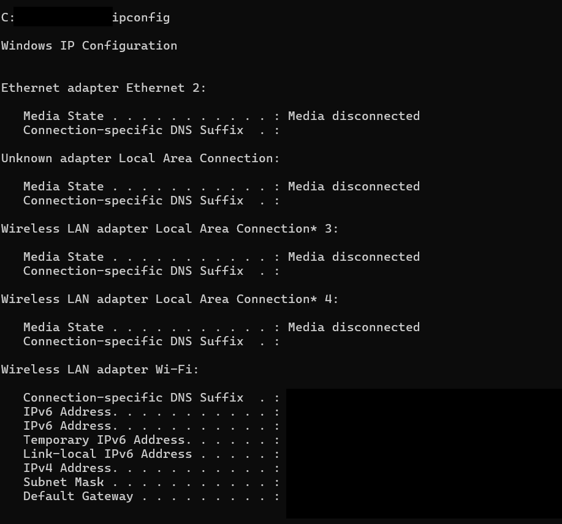
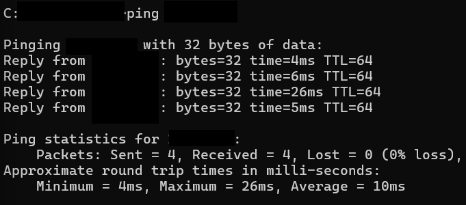

# Ticket #001 — Network & DNS Troubleshooting

## Ticket Information

**User:** Sarah M.  
**Issue:** No Internet Connection  
**Environment:** Windows 11  
**Priority:** Normal  
**Status:** Resolved / Lab Completed

## Problem Description

The user reported that the computer appeared to be connected to Wi-Fi, but websites were not loading. Other users on the network appeared to have internet access.

The goal of this troubleshooting lab was to determine whether the issue was related to the computer's IP configuration, local network connectivity, internet connectivity, or DNS resolution.

## Troubleshooting Process

### 1. Checked IP Configuration

I used the following command:

`ipconfig`

I reviewed the computer's network configuration and confirmed that the active Wi-Fi adapter had an IPv4 address, subnet mask, and default gateway.

### 2. Tested Local Network Connectivity

I pinged the default gateway to determine whether the computer could communicate with the local network.

`ping <default-gateway>`

The gateway responded successfully.

**Result:** 4 packets sent, 4 received, 0 lost (0% packet loss).

### 3. Tested Internet Connectivity by IP Address

I tested connectivity to an external public IP address using:

`ping 8.8.8.8`

The external address responded successfully.

**Result:** 4 packets sent, 4 received, 0 lost (0% packet loss).

This confirmed that the computer had working internet connectivity at the IP level.

### 4. Tested DNS Resolution

I used the following command:

`nslookup google.com`

The DNS lookup successfully returned multiple IP addresses for google.com.

This confirmed that DNS name resolution was functioning at the time of testing.

### 5. Performed a Controlled DNS Configuration Test

To gain additional hands-on experience troubleshooting DNS issues, I temporarily changed the IPv4 DNS configuration from automatic DHCP assignment to a manually configured invalid test DNS address.

After changing the IPv4 DNS setting, name resolution continued to function.

Using `nslookup`, I determined that the system was still using an IPv6 DNS resolver. This demonstrated that changing only the IPv4 DNS configuration does not necessarily cause DNS resolution to fail when IPv6 DNS remains available.

The DNS configuration was then restored to automatic DHCP assignment.

### 6. Cleared the DNS Cache

After restoring the network configuration, I cleared the local DNS resolver cache using:

`ipconfig /flushdns`

This ensured that future DNS queries would not rely on previously cached entries.

### 7. Additional Verification

I also used:

`tracert 8.8.8.8`

to examine the network path to an external destination.

The trace reached the destination successfully. Some intermediate routers may not respond to traceroute requests, so an individual timeout does not automatically indicate a connectivity failure.

## Findings

Testing confirmed:

- The computer had a valid network configuration.
- The computer could communicate with the local gateway.
- Internet connectivity by IP address was working.
- DNS resolution was functioning.
- IPv6 DNS remained available during the controlled IPv4 DNS configuration test.

The troubleshooting process did not identify an active network or DNS failure during testing.

## Resolution

The temporary DNS configuration used for testing was removed and DNS settings were returned to automatic DHCP assignment.

The DNS cache was cleared and connectivity was verified again.

## Verification

Final testing confirmed successful local network connectivity, internet connectivity, and DNS name resolution.

## Skills Demonstrated

- Windows 11 network troubleshooting
- TCP/IP fundamentals
- IPv4 and IPv6 awareness
- DHCP configuration
- DNS troubleshooting
- Command Prompt
- `ipconfig`
- `ping`
- `nslookup`
- `tracert`
- DNS cache management
- Structured help-desk troubleshooting
- Technical documentation

## Key Takeaway

This lab reinforced the importance of troubleshooting network problems systematically:

**IP Configuration → Local Network → Internet Connectivity → DNS → Application**

It also demonstrated the importance of following the actual troubleshooting evidence rather than assuming a specific root cause.